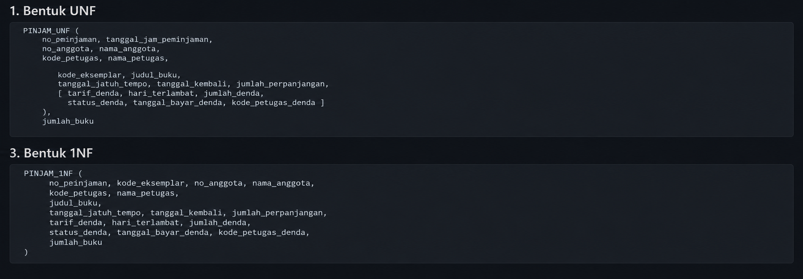
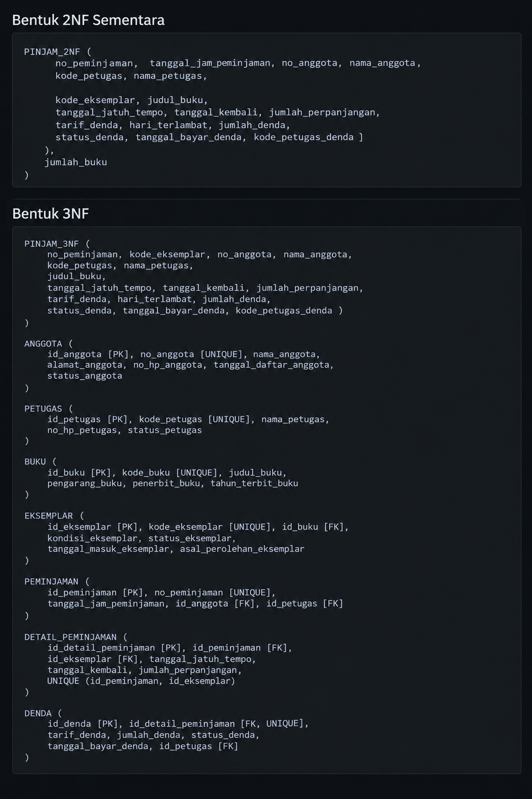

# Laporan Praktikum Basis Data - Pertemuan 04

- **Nama:** Danang Setiawan
- **NIM:** 25430121
- **Kelas:** A
- **Tanggal:** 15 Oktober 2026
- **Dosen:** Dedi Irawan, S.Kom., M.T.I.

## 1. Tujuan Praktikum

Pada Modul 4 saya belajar mengidentifikasi anomali pada data yang belum ternormalisasi, menyusun dependensi fungsional berdasarkan aturan bisnis, dan melakukan normalisasi dari UNF hingga 3NF. Saya juga memeriksa BCNF, menentukan nilai turunan yang disimpan atau dihitung, serta menerapkan proses tersebut pada proyek Perpustakaan Pakde DS.

## 2. Ringkasan Dasar Teori

Normalisasi adalah proses menyusun data ke dalam tabel-tabel agar pengulangan data dan risiko ketidakkonsistenan berkurang. Data yang belum ternormalisasi dapat menimbulkan anomali ubah, sisip, dan hapus.

Dependensi fungsional (`A → B`) berarti suatu nilai A menentukan tepat satu nilai B. Dependensi tersebut harus didasarkan pada aturan bisnis, bukan hanya contoh data. Pada 1NF semua nilai harus atomik dan tidak boleh ada grup berulang. Pada 2NF, atribut bukan kunci tidak boleh bergantung pada sebagian kunci komposit. Pada 3NF, ketergantungan berantai antaratribut bukan kunci perlu dihilangkan. BCNF mensyaratkan setiap penentu merupakan kunci kandidat.

Nilai turunan dapat dihitung dari atribut lain, sedangkan nilai yang merupakan fakta historis perlu dipertimbangkan apakah harus disimpan agar catatan transaksi tetap akurat.

## 3. Hasil Langkah Percobaan

### D.1 — Dari UNF ke 1NF

Saya menyusun bentuk `NOTA_UNF` dari nota penjualan Kopma dan mengidentifikasi grup berulang pada data barang dalam satu nota. Tiga anomali yang ditemukan adalah anomali ubah pada data yang berulang, anomali sisip ketika barang baru belum pernah terjual, dan anomali hapus ketika penghapusan nota dapat menghilangkan informasi barang.

Grup berulang kemudian diubah menjadi baris-baris terpisah pada `NOTA_1NF`. Kunci primernya menggunakan gabungan `no_nota_penjualan` dan `kode_barang` karena satu nota dapat memuat beberapa barang, sedangkan barang yang sama dapat muncul pada nota yang berbeda.

### D.2 — Menuliskan Dependensi Fungsional

Saya menyusun dependensi fungsional berdasarkan aturan bisnis Kopma. Salah satu temuan penting adalah `kode_barang` tidak menentukan `harga_satuan_detail_penjualan`, karena harga pada nota harus tetap sesuai dengan harga saat transaksi berdasarkan AB-04. Harga transaksi ditentukan oleh gabungan nomor nota dan kode barang.

### D.3 — Menuju 2NF dan 3NF

Pada tahap 2NF, atribut yang bergantung pada sebagian kunci komposit dipisahkan ke tabel `PENJUALAN` dan `BARANG`, sedangkan data per barang tetap berada di `DETAIL_PENJUALAN`.

Pada tahap 3NF, data anggota dan petugas dipisahkan ke tabel masing-masing untuk menghilangkan ketergantungan berantai. Nilai seperti subtotal, jumlah penjualan, dan total penjualan pada tabel operasional Kopma diputuskan untuk dihitung ketika dibutuhkan.

### D.4 — Perbandingan dengan Skema Kanonik dan BCNF

Saya membandingkan hasil normalisasi dengan skema kanonik Kopma. Skema kanonik menggunakan kunci pengganti `id_*` sebagai kunci primer, sedangkan kode alami tetap dipertahankan sebagai nilai unik. Saya juga memeriksa BCNF dengan memastikan setiap penentu yang diperiksa merupakan kunci kandidat.

### Bukti tangkapan layar


*Gambar 3.1 Tahapan normalisasi UNF sampai 1NF proyek Perpustakaan Pakde DS.*


*Gambar 3.2 Tahapan normalisasi 2NF sampai 3NF proyek Perpustakaan Pakde DS.*

## 4. Jawaban Titik Analisis

### Titik Analisis 1 — Harga satuan transaksi

`harga_satuan_detail_penjualan` bergantung pada gabungan `no_nota_penjualan` dan `kode_barang` karena harga jual dapat berubah dari waktu ke waktu. Jika harga hanya disimpan pada tabel barang, laporan omzet tahun lalu bisa salah menggunakan harga terbaru dan tidak lagi menunjukkan nilai transaksi yang sebenarnya.

### Titik Analisis 2 — Nilai total operasional dan arsip

Total penjualan pada tabel operasional tidak disimpan karena detail transaksi masih dapat diperbaiki. Sebaliknya, total pada tabel arsip boleh disimpan karena arsip merupakan catatan historis yang harus mempertahankan nilai transaksi pada saat kejadian. Perbedaan keputusan ini sesuai dengan perbedaan fungsi tabel operasional dan tabel arsip.

### Titik Analisis 3 — Informasi pemasok barang

Informasi pemasok yang menyediakan barang dapat ditelusuri melalui tabel `pemasok`, `pembelian`, `detail_pembelian`, dan `barang`. Pemisahan ini memungkinkan satu barang dibeli dari beberapa pemasok serta mempertahankan riwayat pembelian. Jika hanya satu nama pemasok disimpan pada tabel barang, sistem akan kesulitan mencatat beberapa pemasok untuk barang yang sama.

## 5. Hasil Latihan dan Modifikasi

### E.1 — Beberapa nomor telepon pemasok

Agar satu pemasok dapat memiliki beberapa nomor telepon, nomor telepon dipisahkan ke tabel tersendiri. Dengan demikian, data pemasok tidak perlu diulang setiap kali nomor telepon ditambahkan.

```text
PEMASOK (id_pemasok [PK], nama_pemasok, alamat_pemasok, ...)
TELEPON_PEMASOK (id_pemasok [PK, FK], no_telepon [PK])
```

Gabungan `id_pemasok` dan `no_telepon` menjadi kunci primer pada `TELEPON_PEMASOK`. Satu pemasok dapat memiliki beberapa nomor telepon tanpa menyimpan daftar nomor dalam satu kolom.

### E.2 — Anomali ubah jika nama anggota disimpan di penjualan

Jika `nama_anggota` disimpan langsung pada tabel `penjualan`, nama yang sama dapat tercatat di beberapa nota. Jika nama diperbarui hanya pada satu nota, baris lain dapat menyimpan nama lama sehingga data menjadi tidak konsisten.

Contoh berikut hanya ilustrasi struktur yang bermasalah:

| no_nota_penjualan | no_anggota | nama_anggota |
|---|---|---|
| PJ-2609-0142 | A-0125 | Sugeng |
| PJ-2610-0010 | A-0125 | Sugeng |

Contoh perintah yang dapat menimbulkan ketidakkonsistenan jika hanya satu baris diperbarui:

```sql
UPDATE penjualan
SET nama_anggota = 'Sugeng Pratama'
WHERE no_nota_penjualan = 'PJ-2609-0142';
```

Setelah perintah tersebut, dua nota dengan `no_anggota` yang sama dapat memiliki nama berbeda. Karena itu, data nama anggota sebaiknya disimpan pada tabel `anggota` dan dihubungkan melalui kuncinya.

## 6. Tugas Mandiri: Milestone Proyek 4

Saya menerapkan normalisasi pada proyek **Perpustakaan Pakde DS** menggunakan slip peminjaman sebagai dokumen sumber. Bentuk UNF memuat data transaksi peminjaman dan grup berulang yang berisi data setiap eksemplar yang dipinjam.

Setelah grup berulang dihilangkan, bentuk 1NF menggunakan gabungan `no_peminjaman` dan `kode_eksemplar` untuk membedakan satu eksemplar dalam satu transaksi. Pada tahap berikutnya, atribut yang bergantung pada sebagian kunci dipisahkan, lalu ketergantungan berantai antara peminjaman, anggota, petugas, eksemplar, dan buku diperbaiki.

Hasil akhir proyek terdiri atas tujuh tabel:

- `ANGGOTA`
- `PETUGAS`
- `BUKU`
- `EKSEMPLAR`
- `PEMINJAMAN`
- `DETAIL_PEMINJAMAN`
- `DENDA`

Kunci pengganti `id_*` digunakan sebagai kunci primer, sementara kode alami tetap dipertahankan sebagai nilai unik. Catatan denda dipisahkan dari detail peminjaman agar atribut denda tidak menjadi kolom kosong pada detail yang tidak terlambat. Keputusan nilai turunan dan pemeriksaan BCNF dijelaskan lebih lengkap dalam berkas `p04_normalisasi_25430121.md`.

ERD Modul 3 tetap menjadi acuan. Hasil normalisasi 3NF sudah dicocokkan dengan ERD Modul 3 dan kamus data proyek. Tidak ada perubahan entitas atau relasi yang diperlukan, sehingga ERD tidak perlu digambar ulang.

## 7. Pembahasan dan Kendala

Kendala utama pada praktikum ini adalah membedakan ketergantungan pada sebagian kunci dari ketergantungan berantai. Saya mengatasinya dengan memeriksa kembali dependensi fungsional sebelum menentukan tabel yang perlu dipisahkan.

Pada proyek perpustakaan, keputusan penting adalah memperlakukan `hari_terlambat` sebagai nilai turunan yang dihitung dari tanggal jatuh tempo dan tanggal kembali. Sementara itu, `jumlah_denda` disimpan sebagai catatan nilai yang benar-benar ditagihkan. Jika tanggal diperbaiki, nilai denda tersimpan tidak otomatis berubah; penyesuaian perlu diperiksa dan dilakukan secara sengaja.

`jumlah_buku` tidak disimpan karena dapat dihitung dari jumlah baris pada `DETAIL_PEMINJAMAN`. Saya juga memastikan atribut `tanggal_daftar_anggota` tetap ada dalam tabel `ANGGOTA` agar hasil normalisasi sesuai dengan kamus data proyek.

## 8. Kesimpulan

Normalisasi membantu memisahkan data yang memiliki fungsi berbeda, mengurangi pengulangan, dan mencegah anomali ubah, sisip, serta hapus. Melalui Modul 4, saya belajar bahwa pemisahan tabel harus didasarkan pada dependensi fungsional dan aturan bisnis, bukan sekadar menambah jumlah tabel. Pada proyek Perpustakaan Pakde DS, hasil normalisasi digunakan untuk memeriksa kesesuaian skema dengan ERD serta menentukan nilai turunan mana yang dihitung dan mana yang disimpan sebagai catatan historis.

## 9. Pernyataan Penggunaan AI

Saya menggunakan Claude (Anthropic) untuk membantu memahami konsep normalisasi, memeriksa hubungan antara aturan bisnis dan dependensi fungsional, serta menyusun draf penjelasan untuk laporan. Saya perlu memeriksa kembali setiap kode AB, atribut, keputusan desain, dan bukti pekerjaan agar sesuai dengan dokumen proyek serta hasil yang benar-benar saya kerjakan.

## 10. Bukti Git

- **Repositori:** https://github.com/danangst250503-dot/basisdata-25430121


## Checklist

| Status | Jenis                 | Yang harus ada                                                                                    |
| ------ | --------------------- | ------------------------------------------------------------------------------------------------- |
| ✓      | Berkas wajib          | `p04_normalisasi_25430121.md` (proyek)                                                               |
| ✓      | Bukti tangkapan layar | Tabel tahapan UNF → 1NF → 2NF → 3NF                                                               |
| ✓      | Analisis wajib        | Daftar dependensi fungsional, keputusan menyimpan atau menghitung nilai turunan beserta alasannya |