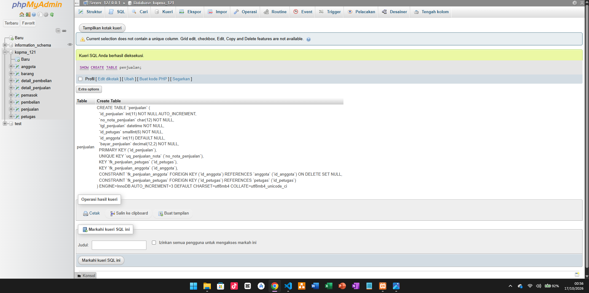
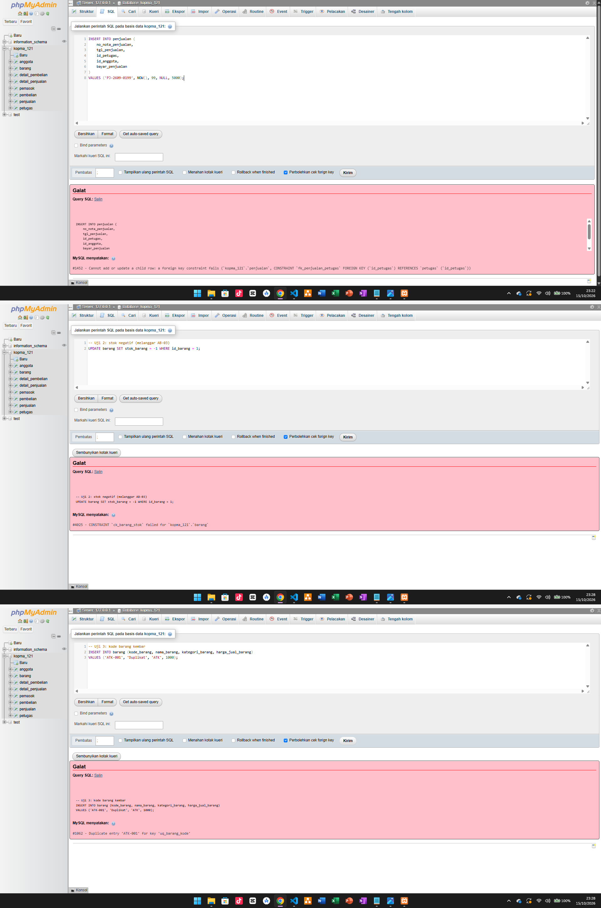
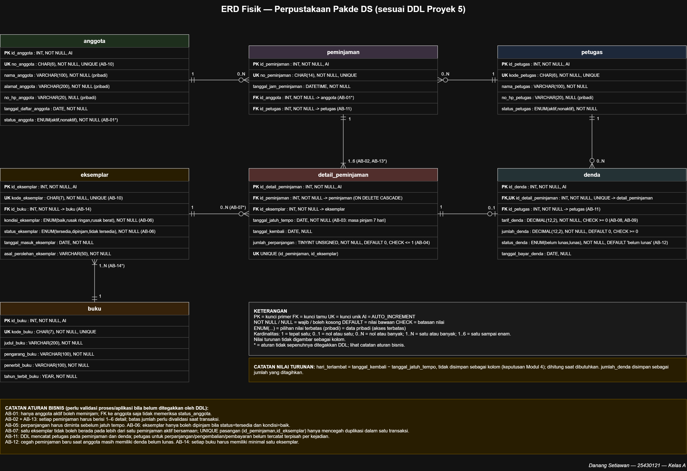
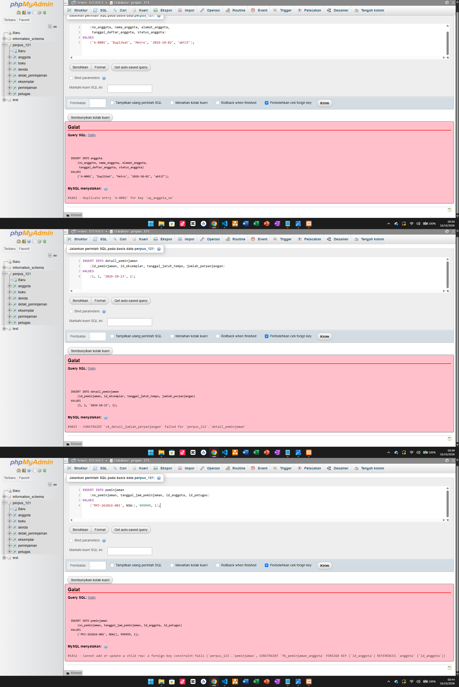

# Laporan Praktikum Basis Data - Pertemuan 05

- **Nama:** Danang Setiawan
- **NIM:** 25430121
- **Kelas:** A
- **Tanggal:** 16 Oktober 2026
- **Dosen:** Dedi Irawan, S.Kom., M.T.I.

## 1. Tujuan Praktikum

1. Mengubah skema relasional hasil normalisasi 3NF menjadi perintah `CREATE TABLE` dengan tipe data yang sesuai.
2. Menerapkan constraint `PRIMARY KEY`, `FOREIGN KEY`, `UNIQUE`, `NOT NULL`, `DEFAULT`, dan `CHECK` berdasarkan aturan bisnis.
3. Mengubah dan menghapus struktur tabel menggunakan `ALTER TABLE` dan `DROP TABLE` dengan urutan yang benar.
4. Menguji bahwa constraint menolak data yang tidak sesuai aturan serta membandingkan struktur fisik basis data dengan ERD.

## 2. Ringkasan Dasar Teori

Data Definition Language (DDL) digunakan untuk membuat, mengubah, dan menghapus struktur basis data melalui perintah seperti `CREATE TABLE`, `ALTER TABLE`, dan `DROP TABLE`. Pemilihan tipe data merupakan keputusan desain yang harus menyesuaikan bentuk nilai yang disimpan. Pada Perpustakaan Pakde DS, `no_peminjaman` menggunakan `CHAR(14)` karena formatnya tetap, `tanggal_jam_peminjaman` menggunakan `DATETIME` untuk mencatat tanggal dan waktu, sedangkan `tarif_denda` dan `jumlah_denda` menggunakan `DECIMAL(12,2)` agar nilai uang memiliki presisi desimal tetap.

Constraint berfungsi menjaga integritas data dengan menerapkan aturan bisnis langsung pada server. `PRIMARY KEY` mengidentifikasi setiap baris, `FOREIGN KEY` menghubungkan tabel yang berkaitan, `UNIQUE` mencegah nilai kunci tertentu berulang, dan `NOT NULL` mewajibkan kolom memiliki nilai. `DEFAULT` memberikan nilai bawaan, sedangkan `CHECK` memeriksa kondisi nilai yang ditetapkan. Sebagai contoh, tabel `detail_peminjaman` menggunakan `CHECK (jumlah_perpanjangan <= 1)` untuk membatasi jumlah perpanjangan sesuai AB-04. Tipe `ENUM` juga membatasi nilai seperti kondisi dan status eksemplar agar sesuai pilihan yang diperbolehkan.

Urutan pembuatan dan penghapusan tabel perlu memperhatikan hubungan kunci tamu. Tabel induk harus dibuat terlebih dahulu sebelum tabel anak yang merujuk kepadanya, sedangkan saat menghapus tabel, urutannya dibalik dari anak ke induk. Pada proyek perpustakaan, tabel `buku` harus tersedia sebelum tabel `eksemplar` dibuat karena `eksemplar` memiliki foreign key ke `buku`. Dengan urutan yang benar, struktur tabel dapat dibuat dan dihapus tanpa konflik akibat relasi antartabel.

## 3. Hasil Langkah Percobaan

### D.1 Membuat Tabel Induk

Tabel induk pada basis data Kopma dibuat terlebih dahulu tanpa mendefinisikan *foreign key*. Tabel yang dibuat meliputi `petugas`, `barang`, `anggota`, dan `pemasok`. Setiap tabel memiliki `PRIMARY KEY` sebagai identitas baris, sedangkan kolom kode yang harus berbeda menggunakan constraint `UNIQUE`.

Pemilihan tipe data disesuaikan dengan nilai yang disimpan, seperti `CHAR` untuk kode dengan panjang tetap, `VARCHAR` untuk teks, serta tipe numerik untuk nilai harga dan jumlah stok. Constraint `CHECK` ditambahkan untuk memastikan nilai stok dan harga jual tidak negatif. Pada tahap modifikasi, constraint `ck_barang_stokmin` juga ditambahkan agar nilai `stok_min_barang` tidak boleh negatif.

### D.2 Membuat Tabel dengan Kunci Tamu

Setelah tabel induk tersedia, tabel transaksi dibuat dengan memperhatikan hubungan antartabel. Tabel transaksi Kopma meliputi `penjualan`, `detail_penjualan`, `pembelian`, dan `detail_pembelian`. Kolom yang berfungsi sebagai *foreign key* harus memiliki tipe data yang sesuai dengan kolom yang dirujuk pada tabel induk.

Relasi tersebut menjaga integritas referensial sehingga data transaksi tidak dapat merujuk ke data induk yang tidak tersedia. Pada `detail_penjualan`, relasi dengan `penjualan` menggunakan `ON DELETE CASCADE`, sehingga detail terkait ikut terhapus ketika data penjualan induknya dihapus. Pada latihan E.2, aturan penghapusan untuk relasi `penjualan` dan `anggota` diubah menjadi `ON DELETE SET NULL` agar data penjualan tetap tersimpan ketika data anggota terkait dihapus, dengan konsekuensi kolom `id_anggota` pada transaksi tersebut menjadi `NULL`.

### D.3 Membuktikan Constraint Bekerja

Pengujian constraint dilakukan untuk memastikan bahwa basis data menolak data yang melanggar aturan. Constraint `FOREIGN KEY` digunakan untuk menjaga agar nilai kunci tamu merujuk pada data induk yang tersedia. Constraint `CHECK` menolak nilai yang tidak memenuhi kondisi, sedangkan `UNIQUE` mencegah nilai yang ditentukan tersimpan lebih dari satu kali.

Pada pengujian Kopma, error 4025 menunjukkan bahwa nilai yang dimasukkan melanggar kondisi `CHECK`, sedangkan error 1062 menunjukkan adanya nilai duplikat yang melanggar constraint `UNIQUE`. Hasil tersebut menunjukkan bahwa aturan integritas dijalankan oleh MariaDB, bukan hanya dicantumkan pada rancangan tabel.

*Gambar 3.1 Struktur tabel `penjualan` Kopma berdasarkan hasil `SHOW CREATE TABLE`.*

*Gambar 3.2 Hasil pengujian constraint pada basis data Kopma.*

### D.4 Mengubah Struktur dan Membandingkan dengan ERD

Perubahan struktur tabel dilakukan menggunakan `ALTER TABLE`. Pada latihan Kopma, constraint `ck_barang_stokmin` ditambahkan untuk memastikan `stok_min_barang` bernilai nol atau lebih. Aturan penghapusan pada foreign key `fk_penjualan_anggota` juga diubah menjadi `ON DELETE SET NULL` agar data penjualan tetap tersimpan ketika anggota terkait dihapus.

Penghapusan tabel perlu memperhatikan hubungan kunci tamu. Tabel anak harus dihapus sebelum tabel induk yang dirujuknya agar tidak terjadi konflik relasi. Hasil struktur fisik basis data kemudian dibandingkan dengan ERD untuk memeriksa kesesuaian nama tabel, kolom, tipe data, primary key, dan foreign key. ERD membantu memperlihatkan hubungan antartabel, sedangkan hasil `SHOW CREATE TABLE` digunakan untuk memeriksa definisi tabel dan constraint yang diterapkan pada MariaDB.

## 4. Jawaban Titik Analisis

### Titik Analisis 1 — ON DELETE CASCADE

`ON DELETE CASCADE` digunakan pada `fk_detail_penjualan` karena detail penjualan merupakan bagian dari transaksi induknya. Ketika transaksi penjualan dihapus, detail-detail yang terkait ikut dihapus sehingga tidak menjadi data yatim. Sebaliknya, relasi `fk_detail_barang` tidak menggunakan `CASCADE` agar barang yang masih tercatat dalam detail transaksi tidak dapat dihapus sembarangan. Jika barang boleh dihapus beserta seluruh detailnya, riwayat transaksi lama dapat kehilangan informasi barang yang pernah dijual sehingga laporan penjualan menjadi tidak lengkap.

### Titik Analisis 2 — Pemetaan Kode Galat ke Aturan Bisnis

- **Error 1452 — `FOREIGN KEY`:** terjadi ketika nilai kunci tamu merujuk pada data induk yang tidak tersedia, misalnya `id_petugas` yang tidak terdapat pada tabel `petugas`. Aturan ini menjaga integritas referensial.
- **Error 4025 — `CHECK`:** terjadi ketika nilai melanggar kondisi yang ditentukan, misalnya `stok_barang` diisi dengan angka negatif meskipun harus bernilai nol atau lebih.
- **Error 1062 — `UNIQUE`:** terjadi ketika nilai yang wajib unik dimasukkan kembali, misalnya kode barang yang sudah digunakan. Aturan ini mencegah identitas barang menjadi duplikat.

Ketiga kode galat tersebut menunjukkan bahwa MariaDB menolak data yang tidak memenuhi constraint pada tabel.

### Titik Analisis 3 — Urutan DROP TABLE

Tabel yang memiliki *foreign key* harus dihapus sebelum tabel induk yang dirujuknya. Oleh karena itu, tabel detail transaksi dihapus terlebih dahulu, dilanjutkan tabel transaksi, kemudian tabel induk yang tidak lagi direferensikan. Jika tabel induk dihapus ketika masih dirujuk oleh tabel anak, MariaDB dapat menolak perintah tersebut karena adanya ketergantungan relasi. Urutan penghapusan yang benar membuat skrip DDL lebih mudah dijalankan ulang tanpa konflik foreign key.

## 5. Hasil Latihan dan Modifikasi

### E.1 — Constraint CHECK untuk Stok Minimum

Constraint `ck_barang_stokmin` ditambahkan pada tabel `barang` untuk memastikan nilai `stok_min_barang` tidak negatif. Setelah constraint diterapkan, pengujian dilakukan dengan mencoba mengubah nilai `stok_min_barang` menjadi `-1`. MariaDB menolak perubahan tersebut dengan error 4025 karena nilai yang dimasukkan tidak memenuhi kondisi `CHECK`.

Pengujian ini menunjukkan bahwa aturan validasi stok minimum diterapkan langsung pada tabel, sehingga nilai yang bertentangan dengan aturan tidak dapat disimpan.

### E.2 — ON DELETE SET NULL pada Relasi Anggota dan Penjualan

Aturan foreign key `fk_penjualan_anggota` diubah menjadi `ON DELETE SET NULL`. Dengan aturan ini, penghapusan data anggota tidak ikut menghapus riwayat penjualan. Sebagai gantinya, nilai `id_anggota` pada transaksi terkait diubah menjadi `NULL`. Kolom `id_anggota` harus mengizinkan nilai `NULL` agar aturan ini dapat diterapkan.

Dari sisi aturan bisnis, perubahan ini memungkinkan transaksi tetap tercatat meskipun data anggota dihapus. Namun, hubungan antara transaksi lama dan anggota yang bersangkutan tidak lagi dapat ditelusuri melalui kolom tersebut. Transaksi anggota yang dihapus juga dapat menjadi sulit dibedakan dari transaksi pelanggan umum apabila keduanya direpresentasikan dengan nilai `NULL`.

Dari sudut pandang perlindungan data pribadi, penghilangan hubungan langsung dengan identitas anggota dapat membantu mengurangi keterkaitan data transaksi dengan individu. Meskipun demikian, penggunaan `SET NULL` saja tidak otomatis menjamin kepatuhan terhadap UU Pelindungan Data Pribadi. Pengelolaan data tetap perlu memperhatikan tujuan pemrosesan, dasar pemrosesan yang sah, pembatasan akses, dan ketentuan retensi data yang berlaku.

## 6. Tugas Mandiri: Milestone Proyek 5

### 6.1 Daftar Tabel dan Constraint

Proyek Perpustakaan Pakde DS menggunakan basis data `perpus_121` dengan tujuh tabel, yaitu `anggota`, `petugas`, `buku`, `eksemplar`, `peminjaman`, `detail_peminjaman`, dan `denda`. Setiap tabel memiliki `PRIMARY KEY` sebagai identitas baris. Constraint tambahan diterapkan sesuai kebutuhan, seperti `UNIQUE`, `FOREIGN KEY`, `NOT NULL`, `DEFAULT`, `ENUM`, dan `CHECK`.

| Tabel | Constraint utama | Aturan bisnis terkait |
|---|---|---|
| `anggota` | `PRIMARY KEY` pada `id_anggota`, `UNIQUE` pada `no_anggota`, serta `NOT NULL` dan `ENUM` untuk status anggota. | AB-01, AB-10. Status aktif dapat dicatat, tetapi pembatasan peminjaman hanya untuk anggota aktif memerlukan pemeriksaan tambahan (*). |
| `petugas` | `PRIMARY KEY` pada `id_petugas`, `UNIQUE` pada `kode_petugas`, serta `ENUM` untuk status petugas. | Mendukung pencatatan identitas petugas dalam transaksi. |
| `buku` | `PRIMARY KEY` pada `id_buku` dan `UNIQUE` pada `kode_buku`. | Menjaga identitas setiap judul buku agar tidak menggunakan kode yang sama. |
| `eksemplar` | `PRIMARY KEY` pada `id_eksemplar`, `UNIQUE` pada `kode_eksemplar`, `FOREIGN KEY` ke `buku`, serta `ENUM` untuk kondisi dan status eksemplar. | AB-06, AB-07, AB-10, AB-14. Validasi kondisi dan status saat peminjaman, larangan peminjaman ganda yang masih aktif, serta kewajiban setiap judul memiliki eksemplar memerlukan pemeriksaan tambahan (*). |
| `peminjaman` | `PRIMARY KEY` pada `id_peminjaman`, `UNIQUE` pada `no_peminjaman`, serta `FOREIGN KEY` ke `anggota` dan `petugas`. | AB-01 dan AB-11. Kunci tamu memastikan anggota dan petugas yang dirujuk tersedia, tetapi tidak otomatis memeriksa status aktif anggota atau mencatat petugas untuk setiap perpanjangan dan pengembalian (*). |
| `detail_peminjaman` | `PRIMARY KEY` pada `id_detail_peminjaman`, `UNIQUE` gabungan pada `id_peminjaman` dan `id_eksemplar`, `FOREIGN KEY` ke `peminjaman` dan `eksemplar`, serta `CHECK (jumlah_perpanjangan <= 1)`. | AB-02, AB-03, AB-04, AB-05, AB-07, AB-13. Batas satu kali perpanjangan ditegakkan oleh `CHECK`, tetapi batas maksimal enam eksemplar per transaksi, minimal satu eksemplar, dan ketentuan waktu memerlukan validasi tambahan (*). |
| `denda` | `PRIMARY KEY` pada `id_denda`, `UNIQUE` pada `id_detail_peminjaman`, `FOREIGN KEY` ke `detail_peminjaman` dan `petugas`, `CHECK` untuk nilai tarif dan jumlah denda yang tidak negatif, serta `ENUM` untuk status denda. | AB-08, AB-09, AB-11, AB-12. Tarif dapat disimpan pada transaksi agar riwayat tetap menggunakan tarif yang berlaku, tetapi perhitungan denda dan larangan peminjaman baru ketika masih ada denda belum lunas memerlukan logika tambahan (*). |

**Catatan:** Tanda (*) menunjukkan aturan bisnis yang tidak sepenuhnya dapat ditegakkan hanya dengan constraint pada DDL. Aturan tersebut dapat memerlukan trigger, prosedur tersimpan, transaksi, atau validasi pada aplikasi. Pada proyek ini, `CHECK (jumlah_perpanjangan <= 1)` menegakkan batas jumlah perpanjangan, tetapi tidak dengan sendirinya memastikan bahwa perpanjangan dilakukan sebelum tanggal jatuh tempo atau menambah masa pinjam tepat tujuh hari.

### 6.2 ERD Fisik

ERD fisik Perpustakaan Pakde DS menggambarkan tujuh tabel beserta atribut, primary key, foreign key, dan hubungan antartabel. Tabel `buku` berhubungan dengan `eksemplar`, sedangkan `peminjaman` berhubungan dengan `anggota` dan `petugas`. Tabel `detail_peminjaman` menghubungkan transaksi peminjaman dengan eksemplar fisik yang dipinjam. Tabel `denda` berhubungan dengan detail peminjaman dan petugas yang menangani denda.

Rancangan ERD juga memperlihatkan aturan relasi dan constraint yang diterapkan pada DDL. Aturan bisnis yang tidak dapat ditegakkan sepenuhnya melalui constraint DDL diberi tanda `*` dan dijelaskan pada pembahasan aturan bisnis. Dengan demikian, ERD fisik menjadi acuan untuk membandingkan rancangan struktur basis data dengan implementasi tabel di MariaDB.

*Gambar 6.1 ERD fisik Perpustakaan Pakde DS dengan tujuh tabel dan hubungan antartabel.*

### 6.3 Analisis Batas P + 2

Dua digit terakhir NIM adalah 21, sehingga nilai parameter proyek dihitung sebagai berikut:

P = (21 mod 9) + 1 = 3 + 1 = 4

Dengan demikian, batas maksimal eksemplar dalam satu transaksi peminjaman adalah:

P + 2 = 4 + 2 = 6 eksemplar

Aturan tersebut sesuai dengan AB-02, yaitu setiap transaksi peminjaman dapat memuat paling banyak enam eksemplar. Namun, `CHECK` biasa hanya memeriksa nilai pada baris yang sedang dimasukkan atau diubah. `CHECK` tidak dapat menghitung jumlah seluruh baris pada `detail_peminjaman` untuk memastikan satu transaksi tidak melebihi enam eksemplar.

Oleh karena itu, penerapan AB-02 memerlukan mekanisme tambahan, misalnya trigger atau prosedur tersimpan yang memeriksa jumlah detail sebelum penambahan data, atau validasi pada aplikasi. Pemeriksaan perlu memperhatikan transaksi bersamaan agar dua penambahan detail tidak membuat jumlah eksemplar melampaui batas.

Prinsip yang sama berlaku untuk AB-13, yaitu setiap transaksi harus memiliki minimal satu eksemplar. Keberadaan satu baris detail tidak dapat dipastikan hanya dengan `CHECK` pada baris tersebut, karena tabel `peminjaman` dan `detail_peminjaman` merupakan tabel yang berbeda. Aturan jumlah minimum perlu diperiksa melalui mekanisme yang sesuai pada tingkat transaksi.

### 6.4 Pemetaan Tipe Data

Tipe data dipilih berdasarkan bentuk, panjang, dan fungsi setiap atribut. Pemetaan berikut menunjukkan pertimbangan utama pada implementasi DDL.

| Atribut atau kelompok atribut | Tipe data | Alasan pemilihan |
|---|---|---|
| Seluruh kolom ID, seperti `id_anggota`, `id_buku`, dan `id_peminjaman` | `INT AUTO_INCREMENT` | Menjadi identitas numerik setiap baris yang dibuat otomatis oleh MariaDB. |
| `no_anggota` dan `kode_petugas` | `CHAR(6)` | Kode menggunakan panjang tetap sehingga sesuai disimpan dengan `CHAR(6)`. |
| `kode_buku` dan `kode_eksemplar` | `CHAR(7)` | Kode memiliki format dan panjang tetap, serta dapat diberi constraint `UNIQUE`. |
| `no_peminjaman` | `CHAR(14)` | Menyesuaikan format nomor transaksi seperti `PMJ-261005-001` yang panjangnya 14 karakter. |
| Atribut nama, judul, alamat, penerbit, dan asal perolehan | `VARCHAR` dengan panjang sesuai kebutuhan | Panjang teks dapat berbeda-beda sehingga tidak harus selalu menggunakan kapasitas karakter maksimum. |
| Atribut nomor telepon | `VARCHAR(20)` | Nomor telepon dapat mengandung angka nol di depan dan bukan nilai yang digunakan dalam perhitungan aritmetika. |
| `tanggal_daftar_anggota`, `tanggal_masuk_eksemplar`, `tanggal_jatuh_tempo`, `tanggal_kembali`, dan `tanggal_bayar_denda` | `DATE` | Menyimpan nilai tanggal tanpa komponen waktu. |
| `tanggal_jam_peminjaman` | `DATETIME` | Menyimpan tanggal sekaligus jam transaksi peminjaman. |
| `tahun_terbit_buku` | `YEAR` | Menyimpan informasi tahun penerbitan buku. |
| `jumlah_perpanjangan` | `TINYINT UNSIGNED` | Cocok untuk jumlah kecil yang tidak memerlukan nilai negatif; batas maksimal satu perpanjangan tetap ditegakkan dengan `CHECK`. |
| `tarif_denda` dan `jumlah_denda` | `DECIMAL(12,2)` | Menyimpan nilai uang dengan presisi desimal tetap sehingga lebih sesuai untuk nominal dibandingkan tipe pecahan aproksimasi seperti `FLOAT`. |
| `status_anggota` dan `status_petugas` | `ENUM('aktif','nonaktif')` | Membatasi nilai status sesuai pilihan yang telah ditentukan. |
| `kondisi_eksemplar` | `ENUM('baik','rusak ringan','rusak berat')` | Menetapkan pilihan kondisi fisik eksemplar yang diperbolehkan. |
| `status_eksemplar` | `ENUM('tersedia','dipinjam','tidak tersedia')` | Membatasi nilai status eksemplar sesuai kategori operasional. |
| `status_denda` | `ENUM('belum lunas','lunas')` | Membatasi status pembayaran denda pada dua nilai yang digunakan dalam sistem. |

Pemilihan tipe data tersebut membantu menjaga konsistensi struktur, membatasi nilai yang tidak sesuai, dan membuat atribut lebih mudah dipahami berdasarkan fungsinya. Tipe data saja tidak cukup untuk menjamin seluruh aturan bisnis, sehingga tetap diperlukan constraint serta validasi tambahan untuk aturan yang melibatkan banyak baris atau beberapa tabel.

### 6.5 Perbandingan Designer dengan ERD

Hasil tampilan Designer pada phpMyAdmin dibandingkan dengan ERD fisik Perpustakaan Pakde DS untuk memeriksa kesesuaian struktur basis data. Pemeriksaan difokuskan pada tujuh tabel yang dibuat, nama tabel, kolom kunci utama, kolom kunci tamu, serta hubungan antartabel.

Hubungan `buku` dengan `eksemplar` ditunjukkan melalui foreign key `id_buku`. Tabel `peminjaman` mengacu pada `anggota` dan `petugas`, sedangkan `detail_peminjaman` mengacu pada `peminjaman` dan `eksemplar`. Tabel `denda` mengacu pada `detail_peminjaman` dan `petugas`. Hubungan tersebut menjadi dasar untuk mencocokkan tampilan Designer dengan ERD fisik.

Perbandingan ini membantu memastikan bahwa relasi utama pada implementasi basis data sesuai dengan rancangan. Namun, tampilan Designer tidak dengan sendirinya membuktikan bahwa seluruh aturan bisnis telah ditegakkan. Constraint seperti `CHECK`, serta aturan yang melibatkan jumlah beberapa baris atau kondisi lintas tabel, tetap perlu diperiksa melalui definisi tabel, pengujian SQL, atau mekanisme validasi tambahan.

### 6.6 Pengujian Constraint Proyek

Constraint pada proyek Perpustakaan Pakde DS diuji dengan memasukkan data yang
melanggar aturan ke basis data `perpus_121`. Ketiga percobaan ditolak oleh MariaDB,
yang membuktikan aturan ditegakkan langsung oleh server.

*Gambar 6.2 Constraint proyek menolak kunci tamu tak dikenal (1452), nomor anggota
kembar pada `uq_anggota_no` (1062), dan perpanjangan melebihi batas pada
`ck_detail_jumlah_perpanjangan` (4025).*

## 7. Pembahasan dan Kendala

Praktikum ini menunjukkan bahwa rancangan tabel harus diterjemahkan ke dalam DDL dengan memperhatikan tipe data, primary key, foreign key, dan constraint lainnya. Tabel induk dibuat sebelum tabel anak agar relasi dapat dibentuk dengan benar, sedangkan penghapusan tabel dilakukan dengan memperhatikan ketergantungan antartabel.

Pada basis data Kopma, pengujian menunjukkan bahwa MariaDB menolak data yang melanggar aturan. Error 1452 berkaitan dengan referensi foreign key yang tidak valid, error 4025 menunjukkan pelanggaran kondisi `CHECK`, dan error 1062 menunjukkan pelanggaran constraint `UNIQUE`. Penambahan `ck_barang_stokmin` juga memperlihatkan bahwa aturan nilai stok minimum dapat diterapkan langsung pada tabel.

Pada proyek Perpustakaan Pakde DS, pengujian `CHECK (jumlah_perpanjangan <= 1)` menolak nilai jumlah perpanjangan sebesar 2 dengan error 4025. Pengujian ini membuktikan bahwa batas jumlah perpanjangan dapat ditegakkan melalui constraint. Namun, beberapa aturan bisnis, seperti batas maksimal enam eksemplar per transaksi, status aktif anggota, dan larangan peminjaman eksemplar yang sedang dipinjam, memerlukan validasi tambahan karena melibatkan data dari beberapa baris atau tabel.

Salah satu hal penting dalam perancangan adalah membedakan aturan yang dapat diterapkan melalui constraint langsung dengan aturan yang membutuhkan logika tambahan. ERD dan tampilan Designer membantu memeriksa hubungan antartabel, sedangkan `SHOW CREATE TABLE` dan pengujian SQL membantu memastikan bahwa struktur serta constraint yang diterapkan sesuai dengan rancangan.

## 8. Kesimpulan

Praktikum ini memberikan pemahaman tentang penerapan DDL untuk membuat, mengubah, dan menghapus struktur tabel serta menerapkan constraint untuk menjaga integritas data. Pengujian pada basis data Kopma dan Perpustakaan Pakde DS menunjukkan bahwa constraint seperti `FOREIGN KEY`, `UNIQUE`, dan `CHECK` dapat menolak data yang melanggar ketentuannya. Melalui proyek perpustakaan, saya juga memahami bahwa tidak semua aturan bisnis dapat ditegakkan dengan constraint sederhana, sehingga beberapa aturan memerlukan validasi tambahan melalui trigger, prosedur tersimpan, atau aplikasi. Perbandingan DDL, hasil pengujian SQL, dan ERD membantu memeriksa kesesuaian antara rancangan dan implementasi basis data.

## 9. Pernyataan Penggunaan AI

Saya menggunakan Claude (Anthropic) sebagai alat bantu untuk menyusun dan memperbaiki redaksi laporan, memahami konsep DDL dan constraint, serta merapikan penjelasan hasil praktikum. Perintah SQL, struktur tabel, dan hasil pengujian tetap perlu dicocokkan dengan implementasi yang saya jalankan pada MariaDB. Penggunaan AI ini dimaksudkan sebagai pendamping belajar, bukan pengganti proses praktikum dan pemahaman saya sendiri.

## 10. Bukti Git

- **Repositori:** https://github.com/danangst250503-dot/basisdata-25430121

Riwayat commit yang digunakan sebagai bukti pengerjaan Milestone Proyek 5 adalah sebagai berikut.

| Hash commit | Pesan commit |
|---|---|
| `a03ee0c` | `p05: perbarui ddl kopma dan bukti` |
| `093320d` | `p05: ddl proyek perpustakaan pakde ds` |
| `d2e8d62` | `p05: tambah ERD fisik perpustakaan pakde ds` |

## Checklist

| Status | Jenis | Yang harus ada |
|---|---|---|
| [✓] | Berkas wajib | `p05_ddl_25430121.sql` (dapat dijalankan ulang) dan ERD fisik `p05_erd_fisik_25430121` |
| [✓] | Bukti tangkapan layar | `SHOW CREATE TABLE` tabel utama; galat FK, UNIQUE, CHECK |
| [✓] | Analisis wajib | Alasan pemilihan tipe data dan constraint; kaitan constraint dengan AB-xx |